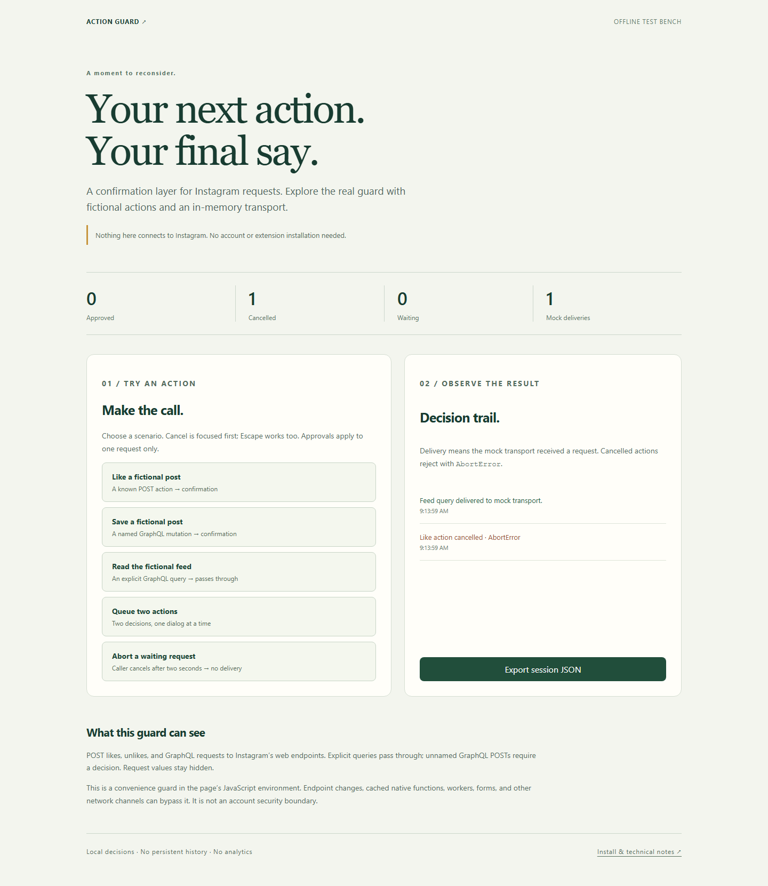

# Instagram Action Guard

A browser extension that pauses Instagram web actions for a deliberate **Allow once** or **Cancel action** decision. Includes an offline, interactive test bench built on the same guard used by the extension.



## Try it without an account

```sh
python -m http.server 8830 --bind 127.0.0.1
```

Open <http://127.0.0.1:8830/demo.html>. The test bench uses fictional operations and an in-memory transport. Try a like, a GraphQL save, a read query, two queued actions, and a caller-aborted request. Export the actual session decisions as JSON. Nothing is sent to Instagram. No build or runtime dependency is needed.

## Install in Chrome

1. Download this repository, or download and extract the ZIP artifact from a successful [verification run](https://github.com/Ashwin-Iyer1/insta_confirm_action/actions).
2. Open `chrome://extensions`, enable Developer mode, select **Load unpacked**, and choose the directory containing `manifest.json`.
3. Reload existing Instagram tabs. Use the extension popup to open the offline test bench.

The manifest adds no extension permissions. It injects two scripts on `https://instagram.com/*` and `https://www.instagram.com/*`. The popup describes installation behavior; it does not claim to verify injection on the current tab.

## Request policy

| Request | Behavior |
| --- | --- |
| POST `/api/v1/web/likes/{numeric-id}/like/` or `/unlike/` | Confirm |
| POST `/api/graphql`, `/graphql`, or `/graphql/query` with a mutation name or query | Confirm |
| POST to those GraphQL endpoints with an opaque/unnamed operation | Confirm as unclassified |
| Explicit GraphQL reads (`…Query`, `query …`, or shorthand selection) | Pass through |
| GET, other hosts, other endpoints | Pass through |

The classifier reads form, JSON, URLSearchParams, FormData and cloned Request bodies. It handles the `x-fb-friendly-name` header. A `container_module` value is not proof of a mutation. Inspection of cloned Request bodies is capped at 128 KiB; oversized or unreadable GraphQL bodies remain unclassified and require a decision.

One dialog is displayed at a time, with at most 20 waiting decisions. Each expires after 30 seconds from enqueueing. Cancel receives initial focus, Escape cancels, and previous focus is restored. Titles are rendered as text, never HTML. Dialog details show endpoint patterns and variable **names**, not values, post IDs, or full payloads.

## Correct cancellation

The original extension returned a fabricated HTTP 200 when a request was blocked. This version rejects cancelled `fetch` calls with `AbortError`. Cancelled XHRs retain status zero and emit `abort` / `loadend`; they do not emit `load`. Aborting or reopening a waiting XHR discards its old decision. Synchronous guarded XHR throws `NotSupportedError`, because an asynchronous confirmation cannot pause it safely.

The page may display its normal network-error UI when an action is cancelled. An approved request still depends on Instagram accepting it; an approval is not evidence of server success.

## Boundaries and privacy

This is a convenience guard, **not an account security boundary**. It runs in the page’s MAIN world. Page scripts can replace or bypass it; cached native methods, workers, forms, beacons, WebSockets, new endpoints and changed operation names are outside its coverage. Explicit reads are recognized by request metadata, not a full GraphQL parser. The extension cannot undo actions already sent.

No request logs, credentials, analytics, or persistent history are stored. Demo exports contain only fictional decisions. The extension does not read your account during installation. Live Instagram behavior and Chrome Web Store distribution have not been validated; tests exercise actual browser fetch/XHR with intercepted offline responses, not a signed-in account.

## Verify and package

Requires Node 22+ and Python 3.10+ for development only.

```sh
npm ci
npm test
npx playwright install chromium
npm run test:ui
npm run package
```

Five classifier tests cover endpoint boundaries, read/mutation policy and bounded input. Nine browser tests cover Request preservation, FormData, hostile labels, FIFO decisions, aborts, timeout, XHR events/reuse, keyboard focus, narrow layouts, and a downloaded JSON artifact. `scripts/package.py` includes only eleven runtime files in `dist/instagram-action-guard-2.0.0.zip`. CI runs the same checks and uploads that installable archive.

Files: `core.js` contains pure classification; `content.js` owns transport wrappers and dialogs; `demo.js` supplies the mock transport; `tests/` exercises their integration. This is a development of the original `insta_confirm_action` experiment, with its earlier implementation retained in Git history.
